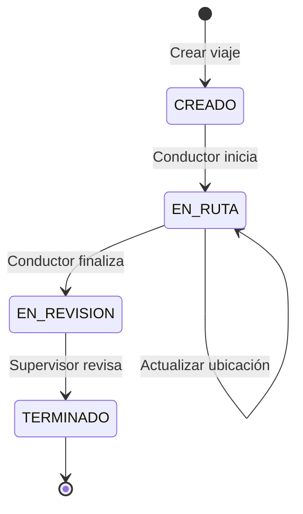
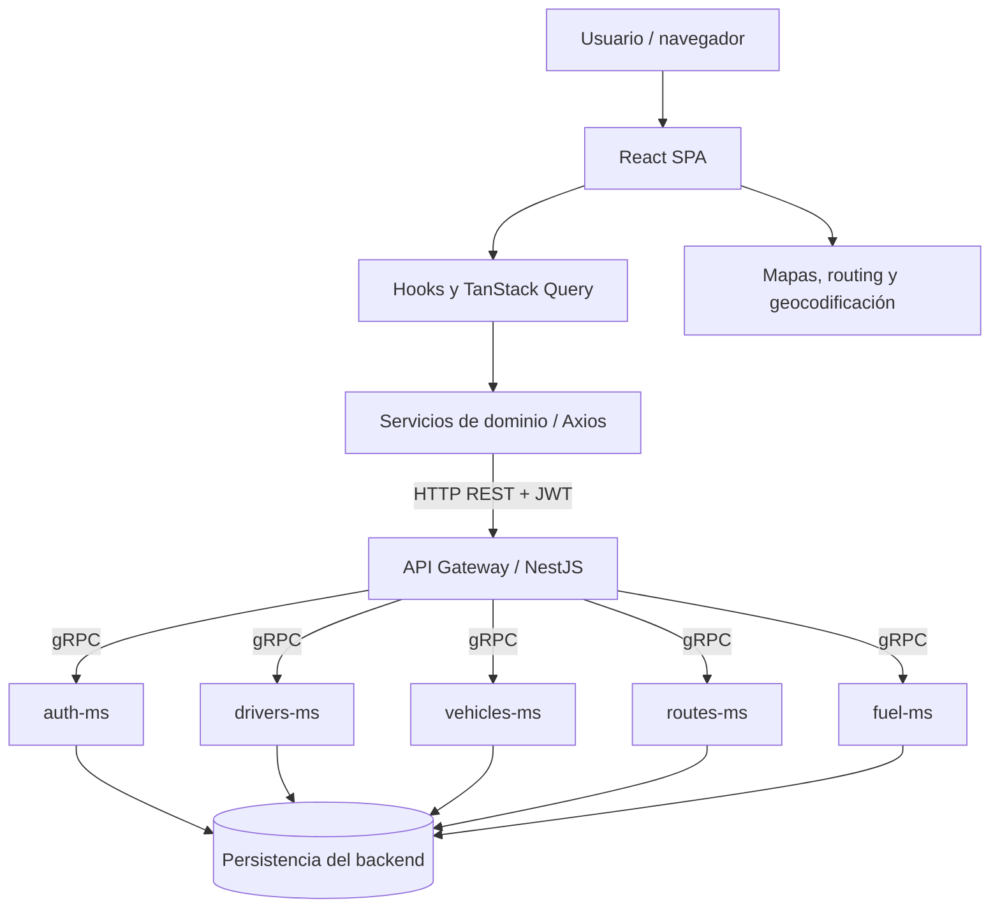

<div align="center">

# Distributed Gasoline System

### Frontend · Fleet & Fuel Management

Plataforma web para la gestión de flotas, planificación de rutas, seguimiento de viajes y análisis del consumo de combustible en un sistema distribuido.


[Descripción](#descripción-general) · [Funcionalidades](#funcionalidades) · [Arquitectura](#arquitectura) · [Instalación](#instalación-y-configuración) · [Backend](https://github.com/Application-Distributed-Gasoline-System/Backend)

</div>

---

## Descripción general

**Distributed Gasoline System** es una aplicación orientada a la administración y supervisión de operaciones de transporte. Su objetivo es centralizar la gestión de vehículos, conductores, licencias, rutas y viajes, facilitando la comparación entre el consumo de combustible estimado y el consumo real registrado durante las operaciones.

Este repositorio contiene el frontend del sistema: una Single Page Application (SPA) desarrollada con React y Vite que consume los servicios del backend a través de una API Gateway HTTP. La interfaz permite a administradores, supervisores y conductores participar en diferentes etapas del ciclo de vida de un viaje, de acuerdo con sus roles y los permisos aplicados por el servidor.

El backend se mantiene en un repositorio independiente: [Gasoline System — Backend](https://github.com/Application-Distributed-Gasoline-System/Backend).

## Funcionalidades

| Módulo | Responsabilidad |
| --- | --- |
| Autenticación y perfil | Inicio de sesión, recuperación y restablecimiento de contraseña, gestión del perfil y sesión JWT. |
| Usuarios | Administración de cuentas, edición, desactivación y restauración mediante los servicios de usuarios. |
| Conductores | Gestión de conductores, disponibilidad y licencias asociadas. |
| Tipos de licencia | Administración del catálogo, inclusiones y relaciones entre tipos de licencia. |
| Vehículos | Administración de modelos y unidades, diferenciados en vehículos livianos y pesados; requisitos de licencia. |
| Rutas | Creación, consulta, edición y eliminación de rutas; selección geográfica del origen y destino. |
| Viajes | Creación y asignación de viajes, consulta por estado, inicio, actualización de ubicación, finalización y revisión. |
| Consumo de combustible | Visualización de combustible estimado y real, diferencias, eficiencia e indicadores de operación. |
| Reportes | Dashboard administrativo, detalle por vehículo, conductor y ruta, y generación de reportes PDF. |

### Gestión de flotas y rutas

La aplicación distingue entre modelos de vehículos y unidades individuales, con vistas específicas para flotas livianas y pesadas. Durante la creación de un viaje, los servicios permiten consultar conductores y vehículos asignables, incluyendo filtros por licencia del conductor y tipo de vehículo de la ruta.

La integración con Leaflet, React Leaflet y Leaflet Routing Machine permite seleccionar puntos en el mapa, visualizar trayectos y obtener distancias calculadas por el servicio de enrutamiento. El servicio de geocodificación utiliza OpenCage para consultar direcciones a partir de coordenadas y viceversa.

Las funciones de ubicación dependen de los permisos del navegador y de la disponibilidad de los servicios geográficos externos. La interfaz representa las ubicaciones registradas; no debe interpretarse como un sistema de rastreo GPS continuo.

### Ciclo de vida de los viajes

El módulo de viajes organiza las operaciones en un tablero por estado y permite consultar el detalle de cada viaje. Los cambios de estado se solicitan al backend mediante acciones específicas.



| Estado | Descripción |
| --- | --- |
| `CREADO` | Viaje registrado, pendiente de inicio. |
| `EN_RUTA` | Viaje iniciado, con posibilidad de actualizar su ubicación y finalizarlo. |
| `EN_REVISION` | Viaje finalizado por el conductor, pendiente de revisión del supervisor. |
| `TERMINADO` | Viaje revisado, con sus datos finales disponibles para análisis. |

El detalle permite consultar información de la ruta, vehículo, conductor, combustible estimado y real, y ubicación registrada cuando está disponible. La revisión contempla la confirmación del odómetro final y comentarios; la API ofrece además una operación para calcular métricas sin persistirlas.

### Dashboard y reportes

El dashboard administrativo consume los endpoints del servicio de combustible y presenta indicadores de viajes y eficiencia, comparaciones de consumo estimado frente al real y desgloses por tipo de vehículo, conductor y ruta.

Los reportes PDF implementados en el dashboard se organizan en tres categorías:

- **Maquinaria y tipo de vehículo:** análisis del consumo por clasificación de vehículos.
- **Conductores:** análisis del consumo asociado a sus operaciones.
- **Rutas:** análisis del consumo por recorridos.

Los usuarios administradores pueden seleccionar intervalos de fechas, consultar los resultados y acceder a los visores PDF. Las métricas provienen de las respuestas del backend; la interfaz no sustituye las reglas de cálculo del servidor.

## Roles y control de acceso

| Rol | Funciones principales en el frontend |
| --- | --- |
| `ADMIN` | Dashboard, reportes, usuarios, conductores, tipos de licencia y rutas; acceso al módulo de viajes y gestión de flota desde el menú administrativo. |
| `SUPERVISOR` | Acceso al módulo de viajes y revisión de viajes en estado `EN_REVISION`. |
| `DRIVER` | Acceso al módulo de viajes; inicio, actualización de ubicación y finalización según el estado del viaje. |

Las rutas de viajes están habilitadas para los tres roles autenticados. Las acciones mostradas en el detalle dependen del rol y el estado. Las vistas de modelos y unidades de vehículos requieren autenticación a nivel de router, aunque el menú administrativo restringe su visibilidad; el backend debe verificar los permisos de cada operación.

El frontend utiliza `AuthContext`, `ProtectedRoute` y `Can` para gestionar la sesión y la visibilidad de las acciones. Los tokens JWT se adjuntan a las solicitudes con el esquema `Authorization: Bearer <token>`.

> El control de acceso en el navegador mejora la experiencia de usuario, pero no constituye una frontera de seguridad. La API Gateway y los microservicios deben validar la identidad, los roles y la autorización sobre los recursos.

## Stack tecnológico

| Tecnología | Versión declarada | Uso |
| --- | --- | --- |
| React | 19.1 | Componentes e interfaz de usuario. |
| JavaScript | ES Modules / JSX | Lógica de aplicación. |
| Vite | 7.1 | Desarrollo, bundling y build de producción. |
| Tailwind CSS | 4.1 | Estilos utilitarios y diseño adaptable. |
| shadcn/ui / Radix UI | Componentes locales | Primitivas y componentes de interfaz. |
| React Router DOM | 7.9 | Navegación de la SPA y rutas protegidas. |
| TanStack Query | 5.90 | Consultas, caché e invalidación de estado del servidor. |
| TanStack Table | 8.21 | Tablas de datos. |
| Axios | 1.12 | Cliente HTTP e interceptores. |
| React Hook Form | 7.63 | Gestión de formularios. |
| Leaflet / React Leaflet | 1.9 / 5.0 | Mapas y visualización geográfica. |
| Leaflet Routing Machine | 3.2 | Visualización y cálculo de trayectos. |
| Recharts | 3.3 | Gráficos e indicadores. |
| React PDF / jsPDF | 4.3 / 3.0 | Generación de documentos PDF; el repositorio incluye ambas bibliotecas. |
| ESLint | 9.36 | Análisis estático de JavaScript. |
| Docker / Nginx | — | Empaquetado y servicio de archivos estáticos. |

Las versiones corresponden a las dependencias declaradas en [`package.json`](package.json); el lockfile determina las versiones exactas instaladas.

## Arquitectura

El frontend funciona como cliente de una arquitectura distribuida. Las páginas y componentes de React utilizan hooks y servicios de dominio para consultar la API Gateway. Esta coordina la comunicación con los microservicios del backend mediante gRPC. El navegador no accede directamente a las bases de datos ni a los endpoints internos de gRPC.



El diagrama representa las responsabilidades lógicas, no una topología física de despliegue. La persistencia y el descubrimiento de servicios se administran desde el repositorio del backend.

### Organización del código

```text
Distributed-Gasoline-System-Frontend/
├── src/
│   ├── assets/             # Recursos gráficos
│   ├── components/         # UI y componentes de cada dominio
│   │   ├── admin/reports/  # Visores y componentes PDF
│   │   ├── drivers/        # Conductores y licencias
│   │   ├── fuel/           # Gráficos de consumo
│   │   ├── license-types/  # Catálogo e inclusiones
│   │   ├── routes/         # Selector geográfico de rutas
│   │   ├── trips/          # Tarjetas y acciones de viajes
│   │   ├── users/          # Formularios de usuarios
│   │   ├── vehicles/       # Modelos y unidades
│   │   └── ui/             # Componentes reutilizables
│   ├── context/            # Contexto de autenticación
│   ├── hooks/              # Hooks de dominio y sesión
│   ├── inc/                # Navegación, providers, temas y utilidades UI
│   ├── layouts/            # Layout administrativo y de autenticación
│   ├── lib/                # React Query y utilidades compartidas
│   ├── pages/              # Vistas asociadas a rutas
│   ├── services/           # Cliente HTTP y servicios de dominio
│   ├── utils/              # Protección de rutas, tokens y manejo de errores
│   ├── App.jsx             # Router y composición principal
│   └── main.jsx            # Punto de entrada
├── public/                 # Archivos públicos
├── back-example/           # Código de referencia de integración con el backend
├── .env.example            # Plantilla de configuración
├── Dockerfile-gasoline-system
├── docker-compose.yml
├── nginx.config
├── package.json
└── vite.config.js
```

El árbol resume los módulos del sistema de combustible. El repositorio conserva algunos archivos del proyecto hospitalario anterior que no forman parte de las rutas activas de Gasoline System. `back-example/` es código de referencia, no el backend que se ejecuta con este frontend.

## Instalación y configuración

### Requisitos previos

- Node.js 22.12 o superior dentro de una rama compatible con Vite 7 (recomendado: Node.js 22 LTS actualizado).
- npm y Git.
- API Gateway y servicios necesarios del [backend](https://github.com/Application-Distributed-Gasoline-System/Backend) en funcionamiento.
- Docker y Docker Compose, opcionales para servir el frontend en contenedor.

Vite 7 requiere Node.js 20.19+ o 22.12+. Se recomienda Node.js 22 LTS en lugar de la versión 18 que utilizaba la documentación anterior.

### 1. Clonar el repositorio

```bash
git clone https://github.com/JoelBonillaG/Distributed-Gasoline-System-Frontend.git
cd Distributed-Gasoline-System-Frontend
```

### 2. Instalar dependencias

```bash
npm ci
```

El proyecto dispone de `package-lock.json`. `npm ci` permite reproducir las dependencias registradas en dicho archivo. Si se modifica el manifiesto de dependencias, usar `npm install` y revisar los cambios en el lockfile.

### 3. Configurar las variables de entorno

Copiar la plantilla de configuración si todavía no existe un `.env` local:

```bash
# Linux / macOS / Git Bash
cp .env.example .env
```

```powershell
# Windows PowerShell
Copy-Item .env.example .env
```

Configurar la dirección HTTP de la API Gateway:

```dotenv
VITE_API_URL=http://localhost:8080
```

| Variable | Descripción |
| --- | --- |
| `VITE_API_URL` | URL base de la API Gateway que será utilizada por Axios. |

No incluir contraseñas ni secretos en variables `VITE_`: sus valores pueden quedar incorporados al JavaScript distribuido al navegador. Si se utiliza un backend remoto, configurar una URL accesible desde el navegador y los orígenes CORS correspondientes en el servidor.

### 4. Iniciar el backend

Seguir las instrucciones del [README del backend](https://github.com/Application-Distributed-Gasoline-System/Backend) para configurar y levantar sus servicios. Para el entorno local, la URL de ejemplo del frontend apunta al puerto `8080` de la API Gateway.

El Docker Compose de este repositorio solo levanta el frontend; no inicia la API Gateway ni los microservicios.

### 5. Ejecutar el frontend

```bash
npm run dev
```

Abrir **http://localhost:5174**. Vite tiene configurado ese puerto de forma explícita.

## Rutas principales

| Ruta | Vista |
| --- | --- |
| `/login` | Inicio de sesión. |
| `/password-recovery`, `/reset-password` | Recuperación y restablecimiento de contraseña. |
| `/profile` | Perfil del usuario. |
| `/trips` | Tablero de viajes. |
| `/trips/create` | Creación de viaje. |
| `/trips/view/:id` | Detalle del viaje. |
| `/vehicles/light/models`, `/vehicles/light/units` | Vehículos livianos. |
| `/vehicles/heavy/models`, `/vehicles/heavy/units` | Vehículos pesados. |
| `/admin/users` | Usuarios. |
| `/drivers`, `/license-types` | Conductores y tipos de licencia. |
| `/routes`, `/routes/create`, `/routes/edit/:id`, `/routes/view/:id` | Administración de rutas. |
| `/dashboard` | Dashboard y reportes. |
| `/dashboard/vehicle/details` | Detalle de consumo por vehículo. |
| `/dashboard/vehicles/:vehicleId/routes` | Rutas asociadas al vehículo. |
| `/dashboard/drivers/:driverId/trips` | Viajes del conductor. |
| `/dashboard/routes/:routeId/trips` | Viajes asociados a la ruta. |

Las rutas administrativas están sujetas a las restricciones definidas en [`src/App.jsx`](src/App.jsx). El inicio autenticado redirige al tablero de viajes.

## Integración con la API Gateway

Los servicios del frontend utilizan una instancia compartida de Axios (`src/services/api.js`) con URL base configurable, timeout de 10 segundos e interceptores para adjuntar el token de acceso y manejar errores HTTP. Una respuesta `401` fuera del endpoint de login limpia la sesión local y redirige al inicio de sesión.

Algunos endpoints consumidos por el frontend:

| Método | Endpoint | Propósito |
| --- | --- | --- |
| `GET` | `/drivers` | Consultar conductores. |
| `GET` | `/license-types` | Consultar tipos de licencia. |
| `GET` | `/vehicles/models` | Consultar modelos. |
| `GET` | `/vehicles/units` | Consultar unidades. |
| `GET` / `POST` | `/routes` | Consultar y crear rutas. |
| `GET` / `POST` | `/trips` | Consultar y crear viajes. |
| `POST` | `/trips/:id/start` | Iniciar un viaje. |
| `PUT` | `/trips/:id/location` | Actualizar ubicación registrada. |
| `POST` | `/trips/:id/finish` | Finalizar un viaje. |
| `POST` | `/trips/:id/review` | Revisar un viaje. |
| `POST` | `/trips/:id/calc-metrics` | Calcular métricas sin persistirlas. |
| `GET` | `/fuel/kpis` | Consultar indicadores. |
| `GET` | `/fuel/reports/general` | Comparar consumo estimado y real. |
| `GET` | `/fuel/reports/vehicle-detail` | Reporte por vehículo. |
| `GET` | `/fuel/reports/driver-ranking` | Ranking de conductores por viajes. |
| `GET` | `/fuel/reports/machinery-type` | Datos del reporte de maquinaria. |
| `GET` | `/fuel/reports/driver-consumption` | Datos del reporte por conductor. |
| `GET` | `/fuel/reports/routes-consumption` | Datos del reporte por ruta. |

Esta es una selección de las solicitudes presentes en el cliente, no una especificación exhaustiva ni una garantía de disponibilidad de todos los endpoints. Los contratos y reglas del servidor pertenecen al backend.

## Build y despliegue

### Build de producción

```bash
npm run build
npm run preview
```

El build genera los archivos estáticos en `dist/`. El comando `preview` permite revisar el resultado localmente y no sustituye un servidor de producción.

### Docker y Nginx

El repositorio incluye un Dockerfile multi-stage: la primera etapa compila la aplicación con Node.js y la segunda sirve los archivos generados mediante Nginx. La configuración `nginx.config` redirige las rutas de la SPA a `index.html` cuando corresponde.

**Antes de construir:** el Dockerfile actual utiliza `node:18-alpine`, una versión incompatible con los requisitos de Vite 7. Actualizar la imagen de la etapa de build a `node:22-alpine` antes de ejecutar estos comandos.

```bash
docker compose up --build -d
```

El servicio `gasoline_frontend` publica el puerto `5174` del host hacia el puerto `80` del contenedor. Abrir **http://localhost:5174**.

```bash
docker compose logs -f gasoline_frontend
docker compose down
```

`VITE_API_URL` se pasa al build mediante `build.args`; cambiarlo requiere reconstruir la imagen. No se configura dinámicamente al iniciar Nginx. En producción, utilizar HTTPS y una API accesible desde los navegadores de los usuarios.

## Comandos de desarrollo

| Comando | Descripción |
| --- | --- |
| `npm ci` | Instalar dependencias según el lockfile. |
| `npm run dev` | Iniciar Vite en desarrollo. |
| `npm run build` | Construir la aplicación para producción. |
| `npm run preview` | Previsualizar el build. |
| `npm run lint` | Ejecutar ESLint. |
| `docker compose up --build -d` | Construir y ejecutar el frontend en Docker. |
| `docker compose down` | Detener y eliminar los contenedores del Compose. |

El manifiesto actual no define un script automatizado de pruebas. Para verificar una instalación, ejecutar el análisis estático y el build, e integrar el frontend con el backend para comprobar autenticación, permisos, asignación de vehículos, transiciones de viaje y generación de reportes.

## Consideraciones de seguridad y mantenimiento

- La sesión utiliza un JWT almacenado en `localStorage`; evitar exponerlo a scripts no confiables y evaluar una estrategia de sesión con cookies HttpOnly si la arquitectura evoluciona.
- La autorización definitiva corresponde al servidor, incluso cuando una acción se oculta en la interfaz.
- Las solicitudes a mapas y geocodificación dependen de proveedores externos. Revisar sus cuotas, condiciones y gestión de credenciales antes de un despliegue público.
- Evitar registrar datos sensibles en la consola del navegador; revisar los logs de autenticación y errores de la API.
- Los documentos `REPORTS_DOCUMENTATION.md` y `TUTORIAL_USO.md` todavía describen el sistema hospitalario anterior. No constituyen guías vigentes de Gasoline System y requieren una actualización independiente.

## Repositorios relacionados

| Repositorio | Descripción |
| --- | --- |
| [Distributed-Gasoline-System-Frontend](https://github.com/JoelBonillaG/Distributed-Gasoline-System-Frontend) | Aplicación web React documentada aquí. |
| [Application-Distributed-Gasoline-System/Backend](https://github.com/Application-Distributed-Gasoline-System/Backend) | API Gateway y microservicios NestJS del sistema distribuido. |

## Colaboración

Para cambios en la interfaz o en los contratos HTTP, coordinar las modificaciones con el equipo responsable del backend. Mantener los servicios de dominio separados de las vistas, revisar las restricciones por rol y documentar los cambios de configuración.

Consultar los [contribuidores del frontend](https://github.com/JoelBonillaG/Distributed-Gasoline-System-Frontend/graphs/contributors) para conocer el historial de participación en el proyecto.

---

<div align="center">

**Distributed Gasoline System**

Frontend para la gestión de transporte y el análisis del consumo de combustible.

</div>
